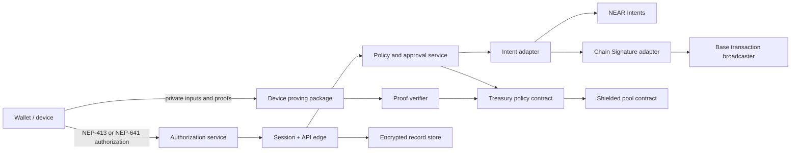

# Scrim backend specification

**Status:** architecture and implementation contract

This document is the implementation source of truth for Scrim’s backend, contracts, client security boundaries, and first release path. It defines a working private-settlement product before the native shielded-note pool is ready, without making the backend a custodian or moving private keys and proof witnesses off the user device.

## 1. Product boundary

Scrim is a private treasury for individuals, teams, and AI agents.

The first working settlement path is confidential settlement through NEAR Intents. The native shielded-note pool is a required production subsystem, but it is developed and independently audited in parallel rather than blocking the first user settlement path.

The first corridor is **USDC on NEAR to USDC on Base**. Arbitrum and Ethereum mainnet follow only after the Base route meets reliability, reconciliation, and incident-response gates.

The system is not a custodian. User keys remain in the wallet or device-managed key store. Proof witnesses and plaintext financial data remain on the user device or in an approved attested execution environment. The backend stores no decryptable note, balance, amount, private key, or proof witness.

## 2. Release phases

| Phase | User capability | Settlement authority | Privacy source |
| --- | --- | --- | --- |
| A — private settlement | Create a treasury, set rules, request USDC NEAR→Base settlement, approve requests, receive encrypted receipts | User wallet and treasury approval | Confidential Intents path |
| B — device proofs | Create reader-bound receipt, solvency, and payroll-total proofs | User device | Device-side proof package |
| C — native pool | Shield, transfer, unshield, and relay from encrypted notes | Shielded-pool verifier contract | Note commitments, nullifiers, and client proofs |
| D — autonomous agents | Opt in an agent to capped autonomous execution | Contract-backed policy + owner recovery | Same settlement and proof layers |

Phase A is intentionally useful on its own. Phase C changes the private-state implementation; it does not replace the treasury, authorization, policy, proof-reader, or settlement abstractions established in earlier phases.

## 3. Account and environment ownership

Before mainnet work, a human owner creates and controls three distinct named NEAR accounts. Scrim must not invent or create account names.

| Role | Purpose | Required separation |
| --- | --- | --- |
| Deployment account | Deploys and upgrades contracts through a controlled release process | Never used for day-to-day treasury approval |
| Treasury administration account | Creates initial treasury configuration and recovery roles | Never used as a payout address |
| Payout account | Receives any event or prize payout | No contract deployment privileges |

The deployment account is protected by hardware-backed signing and a documented recovery process. Production environments use separate RPC credentials, encrypted-record storage credentials, telemetry credentials, and release permissions. No secret appears in source control or browser code.

## 4. System topology



`SP` is not on the critical path of the first release. It becomes the native private-state source of truth in Phase C. The backend and frontend must use versioned adapter interfaces so this transition does not require a product rewrite.

## 5. Trust boundaries

### Device and wallet

Owns wallet keys, note secrets, witness paths, plaintext payment details, local proof inputs, and plaintext disclosure statements. It signs an exact authorization or transaction only after the user sees its material effect.

### Smart contracts

Own commitments, nullifiers, verification-key references, policy commitments, roles, thresholds, approval state, and settlement authorization state. Contracts never store plaintext note contents or private witnesses.

### Backend

Owns challenge nonces, short-lived authenticated sessions, public policy projections, encrypted record envelopes, quote lifecycle state, idempotency state, and operational logs stripped of sensitive values. It cannot spend user funds or decrypt user-held data.

### Settlement providers and broadcasters

Receive only the exact approved outcome and chain-specific transaction payload required for execution. They never receive a wallet private key, note witness, broad account authority, or unrestricted agent policy.

## 6. Authorization and session flow

Scrim uses wallet authorization rather than email/password sign-in.

1. Client requests a challenge for its intended Scrim origin and network.
2. Authorization service creates a cryptographically random 32-byte nonce, a state value, issue time, expiry, origin, and requested scope. It stores the nonce as single-use.
3. Wallet signs an NEP-413 message destined for the Scrim authorization origin. The payload includes the Scrim session request, challenge identifier, scope, origin, and expiry.
4. Client submits the authorization envelope, never a private key, to the authorization service.
5. The service resolves it using NEP-641 against one recent block hash. It verifies the final resolved payload exactly equals the issued challenge, checks network, account, timestamp, origin, nonce, scope, and expiry, and consumes the nonce atomically.
6. The service creates an httpOnly, Secure, SameSite session cookie with a short lifetime and rotates it after privilege changes. Session records bind account ID, authorization block hash, scopes, device identifier, issued-at time, and session revision.
7. Sensitive actions require a fresh authorization: treasury creation, signer changes, agent autonomous mode, policy relaxation, export generation, proof issuance, and settlement acceptance.

The verifier never trusts an account ID supplied outside a valid resolved authorization. It rejects a stale state, a reused nonce, a mismatched recipient/origin, a different payload, an unresolved authorization branch, or a block-pinning mismatch.

## 7. Treasury and policy model

### Treasury

```ts
type Treasury = {
  id: string
  chain: 'near:mainnet'
  contractAccountId: string
  ownerAccountId: string
  kind: 'individual' | 'team'
  threshold: { required: number; total: number }
  signerAccounts: string[]
  status: 'active' | 'paused' | 'recovery'
  policyVersion: number
  createdAt: string
}
```

Defaults are 1-of-1 for individuals and 2-of-3 for teams. Teams can increase the threshold after creation. A threshold change requires the existing threshold and a fresh authorization from affected signers.

### Agent mandate

```ts
type AgentMandate = {
  id: string
  treasuryId: string
  mode: 'request_only' | 'autonomous'
  assetRules: AssetRule[]
  perActionCap: AmountLimit
  rollingCap: { amount: AmountLimit; windowSeconds: number }
  approvedCounterparties: CounterpartyRule[]
  approvalRule: ApprovalRule
  disclosureRule: DisclosureRule
  recoveryOwner: string
  version: number
  enabled: boolean
}
```

`request_only` is the default and permits an agent to prepare an intent, attach permitted proof metadata, and submit it to a human or treasury approval path. It cannot accept a quote or execute settlement.

`autonomous` is an explicit opt-in. It is valid only when the policy contract stores the exact policy commitment, the mandate is active, the counterparty and amount are allowed, the rolling cap is not exceeded, the approval rule permits it, and the user has not paused or recovered the mandate.

### Payment request

```ts
type PaymentRequest = {
  id: string
  treasuryId: string
  createdBy: { type: 'human' | 'agent'; id: string }
  source: { asset: 'USDC'; network: 'near' }
  destination: { asset: 'USDC'; network: 'base'; recipient: string }
  encryptedDetails: EncryptedEnvelopeRef
  policyVersion: number
  policyDecision: PolicyDecision
  idempotencyKey: string
  status: PaymentStatus
  quote?: IntentQuote
  approvals: Approval[]
  expiresAt: string
}
```

Statuses are `draft`, `policy_rejected`, `awaiting_approval`, `quote_requested`, `quote_presented`, `accepted`, `submitting`, `settled`, `failed`, `expired`, and `cancelled`. Every transition is append-only, idempotent, authorized, and emitted as an audit event.

## 8. Contract interfaces

Contract method names are proposed interfaces. Final serialized arguments, gas, deposits, and storage costs are fixed only after contract implementation and integration tests.

### Treasury policy contract

```text
init_treasury(config, initial_policy_commitment)
propose_policy_update(new_commitment, policy_version, metadata_hash)
approve_policy_update(proposal_id)
finalize_policy_update(proposal_id)
create_settlement_request(request_commitment, policy_version, expiry)
approve_settlement_request(request_id)
cancel_settlement_request(request_id)
authorize_settlement(request_id, accepted_quote_commitment)
pause_agent(agent_id)
recover_agent(agent_id, recovery_action)
get_treasury(treasury_id)
get_request(request_id)
get_policy_commitment(version)
```

Contract state is public governance state. Payment particulars are represented by commitments or encrypted-envelope references, never plaintext counterparties or amounts.

### Shielded pool contract — Phase C

```text
register_asset(asset_config)
shield(asset, public_amount, note_commitment)
transact(proof, public_inputs, input_nullifiers, output_commitments)
unshield(proof, public_inputs, input_nullifiers, recipient, asset, public_amount)
relay(proof, public_inputs, call_commitment, relay_target, relay_args_hash)
get_root()
is_nullifier_spent(nullifier)
get_verification_key(version)
```

`transact`, `unshield`, and `relay` verify proof public inputs, reject duplicate nullifiers, confirm a recognized Merkle root, append output commitments, and emit only minimal standardized events. `relay` must whitelist targets and bind the exact call hash before execution; arbitrary calls are forbidden.

### Proof verification interface

```text
verify_solvency(statement, reader_key, nonce, expiry, proof)
verify_receipt(statement, reader_key, nonce, expiry, proof)
verify_payroll_total(statement, reader_key, nonce, expiry, proof)
```

All verifiers reject a proof after expiry, a reader-key mismatch, nonce reuse, statement mismatch, unknown proving-key version, and invalid proof. They return a minimal result, never the private amount, note, or witness.

## 9. Proof statement model

The first reader classes are payroll recipients, auditors/internal finance, and vendors.

```ts
type ProofStatement = {
  version: 1
  type: 'receipt' | 'solvency' | 'payroll_total'
  treasuryCommitment: string
  readerPublicKey: string
  nonce: string
  expiry: string
  verificationKeyId: string
  statementCommitment: string
}
```

- Payroll recipient receipt: proves the recipient’s specific payment was made without revealing the batch.
- Vendor receipt: proves the specified vendor payment was made.
- Auditor solvency: proves a balance satisfies a stated threshold.
- Auditor payroll total: proves a batch total and recipient count satisfy the stated values.

The client generates the proof and encrypts any detailed presentation payload to the reader key. The backend can route an encrypted envelope but cannot derive the underlying amount or witness. A reader obtains the proof through a share link or direct channel and verifies expiry and binding independently.

## 10. Settlement lifecycle

1. A wallet-authenticated human or request-only agent creates a payment request.
2. The policy service evaluates an immutable policy version. It rejects before quote creation if any hard rule fails.
3. Treasury contract approval state reaches its threshold, where required.
4. Intent adapter requests quotes for USDC on NEAR to USDC on Base.
5. The user sees the exact quote, fees, destination asset, receiver, expiry, and expected result, then provides fresh acceptance authorization.
6. The adapter commits the accepted quote to the treasury request and submits it to the designated settlement path.
7. If a destination-chain transaction needs Chain Signatures, the adapter uses a chain-specific derivation path and constructs a payload with Base chain ID encoded. No path may be reused across chains.
8. The broadcaster submits the signed Base transaction and records transaction references without exposing encrypted payment detail.
9. Independent chain watchers reconcile finality. The request moves to `settled` only after the defined confirmation requirement is reached.
10. An encrypted receipt envelope is produced for the treasury and, when requested, a reader-bound receipt proof is generated by the client.

Quote acceptance has its own expiry. A stale quote, destination mismatch, chain ID mismatch, request commitment mismatch, or changed policy version invalidates execution.

## 11. API boundary

All JSON APIs are versioned under `/api/v1`. API responses never include a private key, witness, decryptable note, raw payment amount, or full encrypted payload unless the request is authorized for the ciphertext itself.

| Endpoint | Caller | Purpose |
| --- | --- | --- |
| `POST /auth/challenge` | unauthenticated client | Create a single-use NEP authorization challenge |
| `POST /auth/verify` | wallet client | Resolve authorization and create session |
| `POST /auth/refresh` | authenticated client | Refresh a short-lived session after fresh authorization |
| `GET /treasuries` | authenticated user | List treasuries for an authorized account |
| `POST /treasuries` | fresh authorization | Create an individual or team treasury request |
| `POST /treasuries/:id/policies` | threshold-authorized signer | Propose a versioned policy commitment |
| `POST /payments` | authorized human or agent | Create an encrypted payment request |
| `POST /payments/:id/quotes` | authorized request owner | Request settlement quotes |
| `POST /payments/:id/accept` | fresh authorization + threshold | Bind and accept a quote |
| `POST /payments/:id/cancel` | authorized actor | Cancel before submission |
| `POST /agents` | threshold-authorized signer | Create an agent mandate |
| `POST /agents/:id/pause` | owner or recovery role | Immediately pause an agent |
| `POST /proofs` | authorized owner | Store encrypted proof delivery metadata only |
| `POST /exports` | fresh authorization + role | Generate encrypted audit export |
| `GET /webhooks/settlement` | provider watcher | Receive and verify settlement events |

Every mutating endpoint requires an idempotency key, session scope, CSRF protection for browser requests, request-size limit, schema validation, audit event, and rate limit. Settlement, policy relaxation, export, and agent-autonomy endpoints additionally require a fresh authorization and intent-specific replay protection.

## 12. Encrypted record store

The encrypted record store is not financial truth. It stores records needed for product operation and recovery:

- encrypted payment detail envelopes;
- encrypted proof delivery envelopes;
- encrypted audit-export artifacts;
- quote references and reconciliation data;
- public request commitments and status projections;
- revocation, expiry, and delivery events.

Each ciphertext envelope includes `version`, `treasuryId`, `recordType`, `createdAt`, `keyReference`, `nonce`, `ciphertext`, and `aadHash`. Associated data binds the treasury ID, record type, schema version, and immutable record ID. The encryption key is derived or wrapped on the client; the server cannot decrypt it.

The existing private object store is appropriate for encrypted exports and encrypted delivery envelopes. It is not a substitute for the contract state, and it is not a replacement for a relational operational database. The production backend needs a transactional relational store for idempotency keys, sessions, quotes, approval state, and reconciliation jobs.

## 13. Threat model and controls

| Threat | Control |
| --- | --- |
| Session replay | NEP-bound nonce, recipient/origin binding, single-use challenge, short session TTL, session rotation |
| Wallet-contract authorization bypass | NEP-641 resolution against one block hash; exact root-payload equality; recursion depth and count limits |
| Quote substitution | Quote commitment, destination, asset, chain, fees, and expiry bound into fresh acceptance authorization |
| Cross-chain signature replay | Unique derivation path per chain; Base chain ID in signed payload; chain-specific transaction builders |
| Agent overspend | Contract-backed immutable policy version, cumulative cap accounting, counterparty allowlist, pause/recovery, threshold escalation |
| Agent policy relaxation | Fresh owner authorization and treasury threshold; immutable policy history |
| Double spend in native pool | Nullifier uniqueness, Merkle-root membership, proof verification, state-transition tests |
| Relay abuse | Explicit target allowlist and call commitment; atomic re-shield requirement; no arbitrary external calls |
| Proof disclosure to wrong reader | Reader-key binding, encrypted presentation envelope, statement nonce, expiry verification |
| Proof replay | Reader-bound nonce, expiry, verifier-side used-nonce policy where the proof type requires single use |
| Server compromise | No private keys/witnesses; client-encrypted records; least-privilege service accounts; key rotation; immutable audit logs |
| Malicious relayer | Client verifies transaction outcome independently; delegated-action expiry and nonce; idempotent submission |
| RPC inconsistency | Multi-provider read quorum for sensitive operations; block-pinned authorization; finality-aware watchers |

## 14. Deployment topology

### Edge and application

- Vercel serves the web application and stateless API handlers.
- Browser sessions use Secure, httpOnly cookies. No wallet secret enters Vercel.
- A separate worker service handles quote polling, settlement finality, exports, proof-delivery retries, and reconciliation. It uses durable jobs and idempotent handlers.

### Persistence

- Transactional Postgres: sessions, nonces, request status, approvals, idempotency records, quote lifecycle, settlement reconciliation, and audit index.
- Private object storage: encrypted export and proof-delivery objects.
- Redis: rate limits, short-lived challenges, distributed locks, and ephemeral quote cache.

### Chain infrastructure

- Multiple NEAR RPC providers for read failover.
- Direct contract RPC for policy and shielded-pool state.
- Intent adapter service with explicit environment and corridor configuration.
- Base broadcaster and confirmation watcher with an isolated signing-request boundary.

### Observability

Metrics record status transitions, latency, failed authorization classes, quote acceptance rate, policy rejection category, settlement finality, and job retries. Logs use request IDs and commitment IDs only; amounts, counterparties, encrypted payloads, authorization blobs, and wallet signatures are redacted.

## 15. Implementation sequence

### Milestone 0 — foundation

1. Replace reduced product documentation with the approved product specification and this backend specification.
2. Create account-role runbook; a human creates the three mainnet accounts and records their identifiers outside source control.
3. Provision Postgres and Redis; bind them to isolated development, staging, and production environments.
4. Add a typed monorepo: web, API, worker, contract, protocol, proving, settlement adapters, and integration tests.

### Milestone 1 — identity and treasury shell

1. Implement NEP-413 challenge issuance and NEP-641 block-pinned resolver.
2. Build session, nonce, and authorization audit tables.
3. Implement wallet-authenticated treasury creation with 1-of-1 and 2-of-3 defaults.
4. Deploy a testnet treasury-policy contract and write contract state-transition tests.

### Milestone 2 — policy and request-only agents

1. Implement versioned policy commitments and agent mandate schema.
2. Implement server policy projection plus contract commitment checks.
3. Implement request-only agent intent creation, human approval, pause, recovery, and audit history.
4. Build encrypted record envelopes and export authorization flow.

### Milestone 3 — USDC NEAR to Base

1. Implement the USDC NEAR→Base corridor adapter using Intents quotes and acceptance.
2. Implement Base-specific transaction construction and distinct derivation path registry.
3. Build quote binding, settlement submission, finality watcher, failure recovery, and reconciliation tests.
4. Run controlled testnet and limited mainnet release with per-treasury limits.

### Milestone 4 — device-side disclosures

1. Define canonical circuit public inputs and reader-bound statement encoding.
2. Implement receipt proof first, then solvency and payroll-total proofs.
3. Implement device key management, encrypted reader delivery, verifier, expiry, and replay tests.
4. Obtain an external cryptography and application-security review before production claims.

### Milestone 5 — native shielded pool

1. Implement the note, commitment, nullifier, Merkle, verifier, and relay contracts on testnet.
2. Build the device prover and formal public-input compatibility tests.
3. Audit all contract/circuit state transitions and recovery paths.
4. Deploy with limited assets and limits, then migrate eligible settlement paths from the initial confidential path.

## 16. Acceptance gates

No milestone progresses based on interface completion alone.

- Identity: replay, recipient mismatch, stale authorization, contract-wallet, and multisig authorization tests pass.
- Policy: every cap, counterparty, threshold, pause, and recovery rule is enforced independently of the UI.
- Settlement: quote substitution, expired quote, Base chain mismatch, derivation path reuse, reorg, and duplicate submission tests pass.
- Proofs: wrong-reader, expired, replayed, changed-statement, and wrong-key-version verification tests fail closed.
- Native pool: nullifier replay, invalid root, malformed proof input, unauthorized relay target, and partial re-shield tests fail closed.
- Operations: recovery drill, incident runbook, key rotation, rollback, reconciliation, and encrypted-export restoration drill pass.
