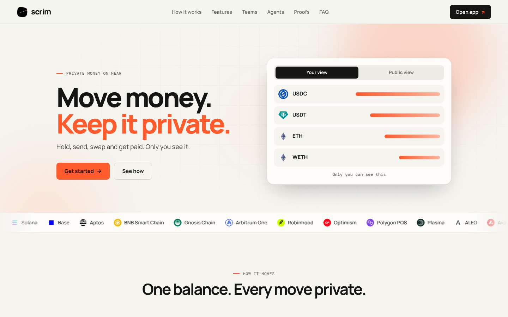
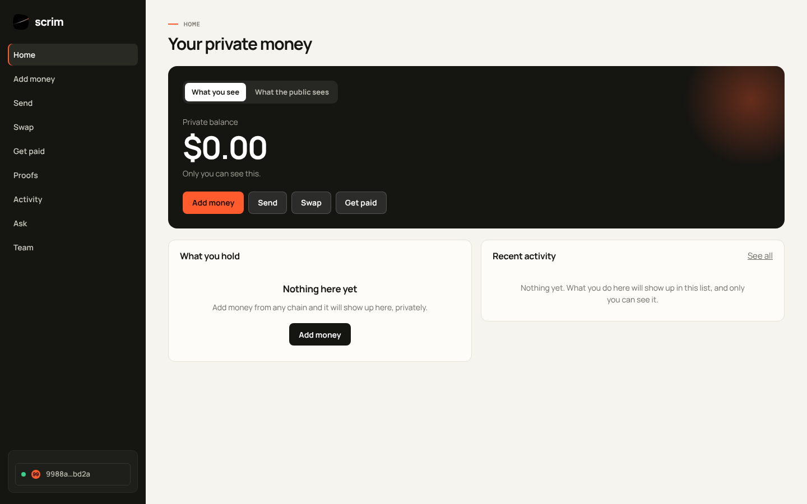
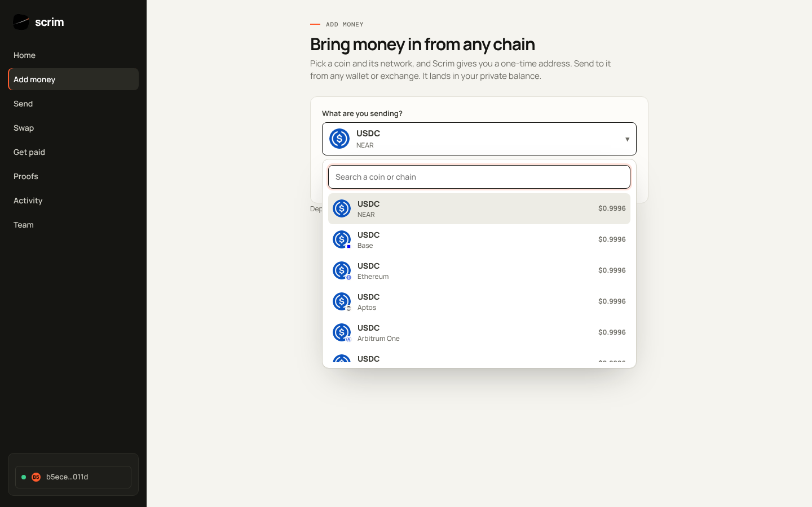
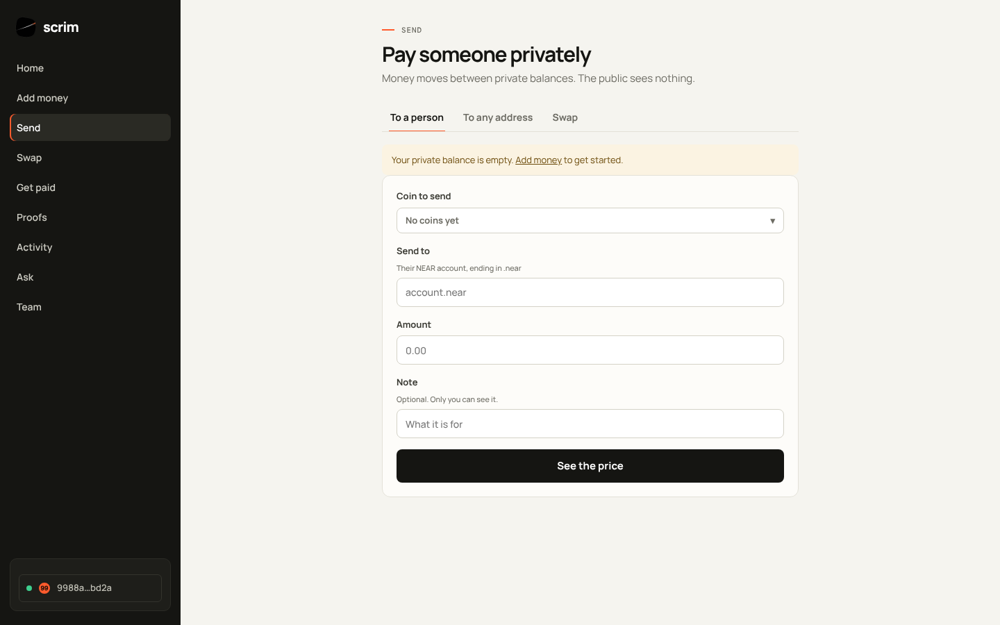
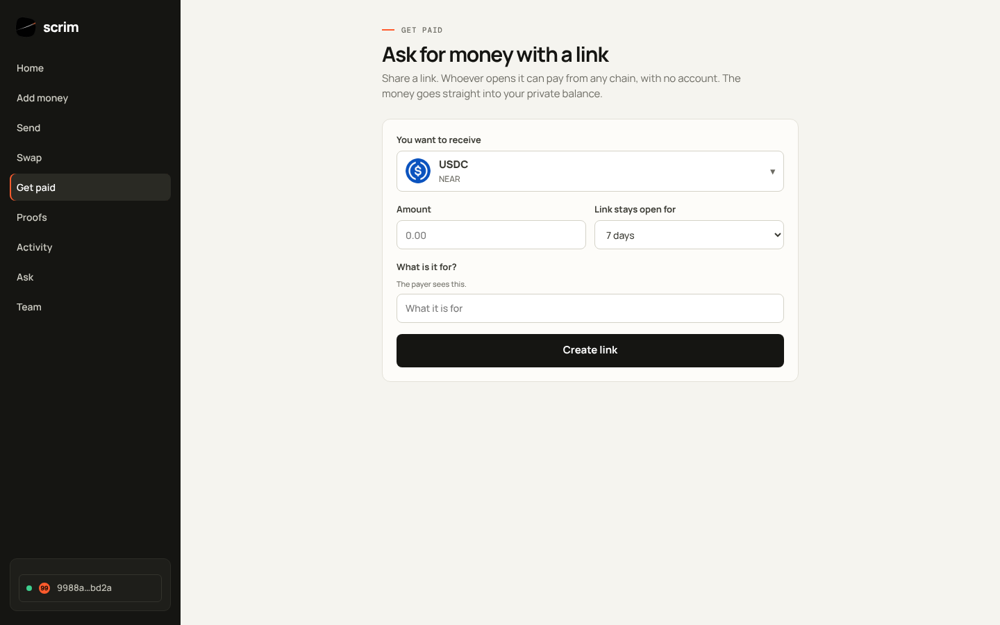
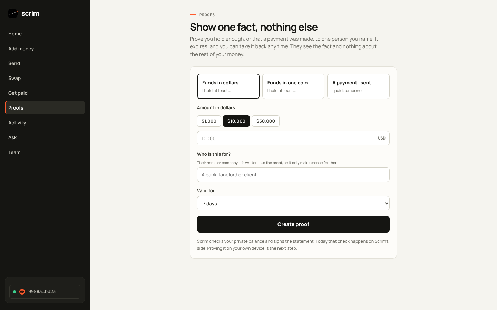
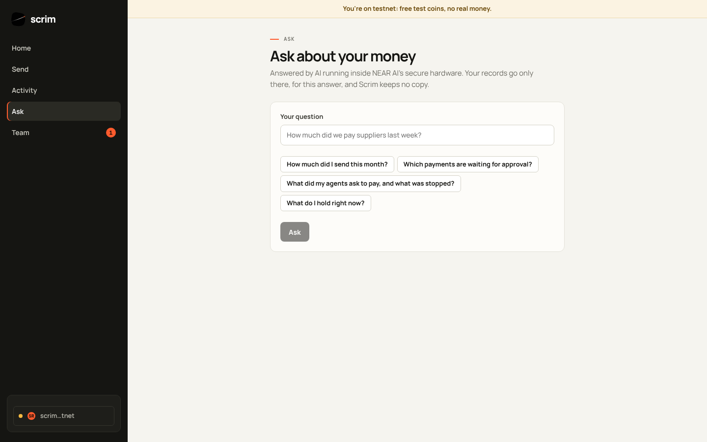
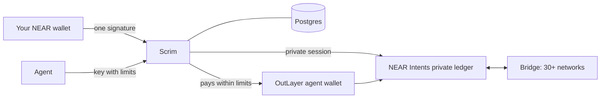

<p align="center">
  
</p>

<h1 align="center">Scrim</h1>

<p align="center">
  <b>Money on NEAR, private when you want it.</b><br>
  Hold, send, swap and get paid in public or in private. You choose, every time.
</p>

<p align="center">
  <a href="https://scrimfinance.vercel.app">Live site</a> ·
  <a href="docs/TRY_IT.md">Try it</a> ·
  <a href="docs/AGENTS_GUIDE.md">Agents</a> ·
  <a href="docs/SELF_HOSTING.md">Run it yourself</a> ·
  <a href="SECURITY.md">Security</a>
</p>

<p align="center">
  <a href="https://github.com/Datwebguy/scrim/actions/workflows/ci.yml"></a>
  <a href="LICENSE"></a>
  <a href="https://near.org"></a>
</p>

<p align="center"></p>

## What is Scrim?

Public blockchains show everything: your balance, who paid you and every payment you send. That suits some payments. For others, like a supplier invoice or a salary, you want more discretion.

Scrim gives you that choice for each payment. Turn on an optional private balance, built on [NEAR Intents](https://near-intents.org), and add money from almost any chain. Pay anyone on any chain, and show one fact to one person when they ask. Share an account with rules, so a payment goes out only when enough people approve. Let software agents pay for you inside limits you set. Ask about your money in plain words and get an answer from AI running in secure hardware.

Scrim never holds your keys or your money. You sign in with your own NEAR wallet and approve every move yourself.

## What you can do

| | |
| --- | --- |
| **Private balance** | Turn it on and your holdings and history live on a private ledger, so the public sees nothing. |
| **Add money** | Pick a coin and a network. You get a one-time address; send from any wallet or exchange and it lands in your private balance (or your wallet). 30+ networks. On EVM chains, **Pay from my wallet** sends it from MetaMask, Rabby or a wallet app's browser in one tap; on Solana, from Phantom, Solflare or Backpack. |
| **Send** | Pay another NEAR account, or any address on any supported chain. Send from your private balance and it cannot be traced back to you, or send from your wallet (public). Zcash payments can go to a shielded (`u1…` or `zs1…`) address. |
| **Swap** | Trade one coin for another, in public or inside your private balance. |
| **Get paid** | Share a payment link. The payer needs no account and can pay from any coin on any chain. |
| **Sell** | Sell a file, a code, a report or your API to agents (over x402) and people (on a pay page), from any coin on any chain. Each sale lands where you choose, your private balance or your wallet; buyers get what you sell once the payment is confirmed. A sales list shows every sale. |
| **Proofs** | Show that you hold at least an amount, or that a payment was made, to one named reader. The proof expires (1, 7 or 30 days), can be taken back, and is checked in the reader's browser without revealing your balance or history. |
| **Accounts with rules** | Approve payments yourself, or share an account where M of N people approve each one. People are invited and join only when they say yes. Spending limits for people and agents, a full history, and a Receipts tab with a spreadsheet download. A small bell shows what is waiting for you. |
| **Ask** | Ask about your own money in plain words ("what did we pay suppliers last week?"). Answered by AI running in NEAR AI Cloud's secure hardware; each answer's signature is checked against the key NEAR AI's attestation report names. |
| **Activity** | Everything you did, in plain words. Private payments are listed only for you; your connected wallet's own transactions (public) are read from the chain. |
| **Agents** | Give software its own key and limits. It asks to pay and people approve, or, with a wallet of its own, it pays by itself within those limits. Agents can pay your links and buy from paid APIs over x402. See [Agents](#agents). |

## A look inside

<table>
  <tr>
    <td></td>
    <td></td>
  </tr>
  <tr>
    <td align="center"><b>Home</b>: your private balance</td>
    <td align="center"><b>Add money</b>: a one-time address on any chain</td>
  </tr>
  <tr>
    <td></td>
    <td></td>
  </tr>
  <tr>
    <td align="center"><b>Send</b>: to a person or any address</td>
    <td align="center"><b>Get paid</b>: a link anyone can pay</td>
  </tr>
  <tr>
    <td></td>
    <td></td>
  </tr>
  <tr>
    <td align="center"><b>Proofs</b>: one fact, for one reader</td>
    <td align="center"><b>Ask</b>: private AI on NEAR AI Cloud</td>
  </tr>
</table>

## Quick start

You need Node 20 or newer and Postgres 14 or newer.

```sh
git clone https://github.com/Datwebguy/scrim.git && cd scrim
npm install
cp .env.example .env.local && npm run keys   # paste the two secrets into .env.local
npm run db:migrate && npm run dev            # http://localhost:3000
```

Open `/app`, choose **Testnet** and connect a NEAR testnet wallet. Testnet uses free coins, so it is the safest place to start. The [step by step walkthrough](docs/TRY_IT.md) shows what to click and what you should see.

## How it works



You sign in with one plain message that names Scrim and cannot move money. When you send, Scrim gets a price from NEAR Intents and your wallet signs that exact transfer. Rules come first: a request that breaks them is stopped before anyone sees it, and the rest waits for the approvals you chose. The full story, from sign in to proofs to Ask, is in [How Scrim works](docs/HOW_IT_WORKS.md).

## Agents

An agent is a helper that spends for you, only inside the rules you set. It can be an AI assistant, a payroll script or a billing job. By default it asks and people approve. With a wallet of its own, it can pay by itself within the same limits, including for pay per use online services through [x402](https://x402.org). The [agents guide](docs/AGENTS_GUIDE.md) covers keys, limits, the MCP server, the HTTPS calls and webhooks.

## Documentation

| | |
| --- | --- |
| [Try it](docs/TRY_IT.md) | A twelve step walkthrough on testnet and mainnet |
| [How it works](docs/HOW_IT_WORKS.md) | Sign in, moving money, proofs, rules and Ask |
| [Agents and x402](docs/AGENTS_GUIDE.md) | Connect software that pays within limits |
| [Run it yourself](docs/SELF_HOSTING.md) | Setup, configuration and deploying to Vercel |
| [Architecture](docs/ARCHITECTURE.md) | The layers and what each part can see |
| [Product](docs/PRODUCT.md) | What Scrim is for and the principles behind it |
| [Backend](docs/BACKEND_SPEC.md) | What the service does, in detail |
| [NEAR services](docs/NEAR_TOOLS.md) | The NEAR tools Scrim uses |
| [Development](docs/DEVELOPMENT.md) | Project layout, checks and tests |

## Security

Your keys stay in your wallet, and every move is a signature over the exact payload you were quoted. Private records are sealed before they reach the database, agent limits are enforced on the server, and one person can never read another person's data. A test proves that last part by trying. The code was reviewed in October 2026 and each confirmed issue was fixed with a regression test. Read [SECURITY.md](SECURITY.md), or report a problem privately by following it.

## Contributing

Issues and pull requests are welcome. Please read [CONTRIBUTING.md](CONTRIBUTING.md) first and run `npm run check` before you open one. By taking part you agree to the [Code of Conduct](CODE_OF_CONDUCT.md).

## License

[MIT](LICENSE)
