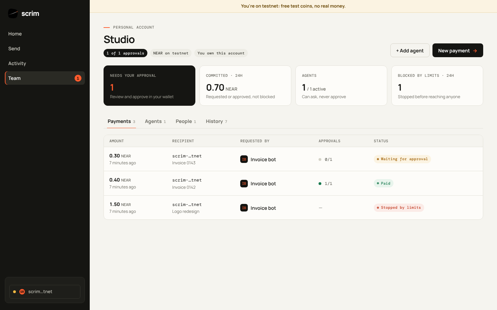
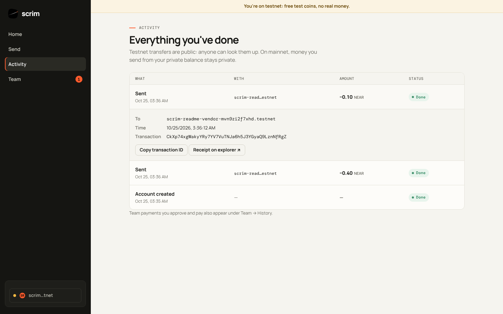
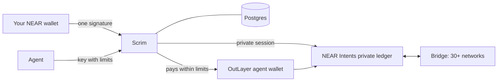
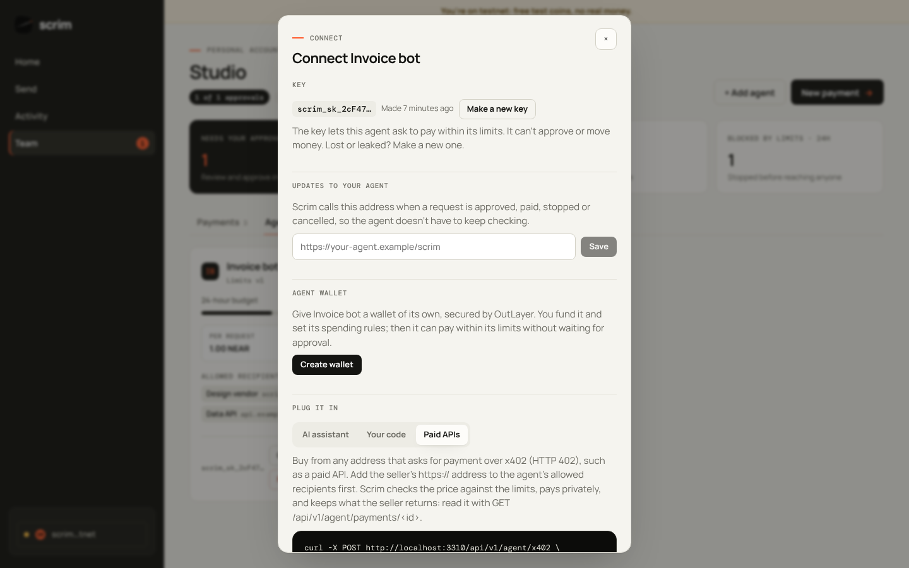
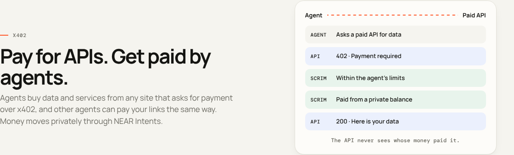

# Scrim

[](https://github.com/Datwebguy/scrim/actions/workflows/ci.yml)
[](LICENSE)
[](https://near.org)

**Private money for people and businesses, on NEAR.**

Hold, send, swap and get paid, and only you see it. Scrim gives you a private balance on top of [NEAR Intents](https://near-intents.org). Add money from almost any chain, pay anyone on any chain, and prove a single fact to a single person when someone asks. Teams get approvals and spending limits. Software agents can ask to pay within rules people control, or pay by themselves from a wallet of their own.

Scrim never holds your keys or your money. You sign in with your own NEAR wallet and approve every move yourself.

<p align="center"></p>

## Quick start

```sh
git clone https://github.com/Datwebguy/scrim.git && cd scrim
npm install
cp .env.example .env.local && npm run keys   # paste the two secrets into .env.local
npm run db:migrate && npm run dev            # http://localhost:3000
```

Open `/app`, choose **Testnet** and connect a NEAR testnet wallet. Full setup is in [Run it yourself](#run-it-yourself).

## Try it

The live site is **https://scrim-alpha.vercel.app**. Each step says what to do and what you should see. Steps 1–8 use testnet and free test coins; steps 9–11 use mainnet.

You need a NEAR testnet account. Any NEAR wallet can create one for free, for example [Meteor](https://wallet.meteorwallet.app) or [HOT](https://hot-labs.org).

1. **Sign in.** Open `/app`, choose **Testnet**, pick your wallet and approve the sign-in message. → You see your account name and its real testnet NEAR balance. The message cannot move funds.
2. **Read your activity.** Open **Activity**. → Your wallet's own transactions, read from the chain, in plain words (Sent, Received, Got test NEAR…). Tap one to see who it was with, the time and the transaction ID.
3. **Send.** Open **Send** and send `0.1` NEAR to another testnet account. → Your wallet asks you to approve; then the transfer appears at the top of **Activity** as *Sent*, *Done*.
4. **Make a team.** Open **Team**, choose *Team*, add a second NEAR account as an approver, require 2 approvals and tap **Create account**. → The team shows "Payments need 2 of 2 approvals".
5. **Add an agent.** In the team, open **Agents → Add agent**. Set *1* per payment, *1.5* per day, and allow one recipient. → Scrim shows the agent's key once (`scrim_sk_…`).
6. **The agent asks to pay.** From any terminal:
   ```sh
   curl -X POST https://scrim-alpha.vercel.app/api/v1/agent/payments \
     -H "Authorization: Bearer scrim_sk_…" -H "Idempotency-Key: try-0001" -H "content-type: application/json" \
     -d '{"recipient":"<the allowed account>","amount":"0.5","memo":"first try"}'
   ```
   → `"status": "awaiting_approval"`. Repeat with `"amount":"2"` and a new key: → `"status": "policy_rejected"`, stopped before anyone sees it.
7. **People approve.** In the team, open the request and tap **Approve with wallet** from each account, then **Pay with my wallet**. → Status moves to *Paid* only after Scrim reads the transfer back from the chain.
8. **Use it from an AI assistant.** Add Scrim as an MCP server (see [Agents](#agents)) and ask the assistant "what can you still spend?". → It calls `get_limits` and answers with the agent's limits and what is left.
9. **Private balance (mainnet).** Sign in on **Mainnet** and open **Add money**. Pick a coin and a network. → A one-time deposit address. What you send there lands in your private balance, and the public chain shows nothing about what you hold.
10. **Get paid by an agent (mainnet).** Make a payment link, then request its agent address:
    ```sh
    curl -i https://scrim-alpha.vercel.app/api/x402/pay/<link code>
    ```
    → `402 Payment Required` with a `PAYMENT-REQUIRED` header listing USDC and USDT routes on eight chains, all delivered into the link owner's private balance.
11. **An agent that pays by itself (mainnet).** In **Agents → Connect**, choose **Create wallet**, keep **Private**, use **Add funds privately**, then **Let it pay by itself**. → Requests inside the agent's limits go straight to *Paid*, from the agent's private balance, with no approval step.

---

## Contents

- [Why Scrim](#why-scrim)
- [Try it](#try-it)
- [What you can do](#what-you-can-do)
- [Testnet and mainnet](#testnet-and-mainnet)
- [How it works](#how-it-works)
- [Run it yourself](#run-it-yourself)
- [Configuration](#configuration)
- [Deploy](#deploy)
- [Agents](#agents)
- [Security](#security)
- [Project layout](#project-layout)
- [Development](#development)
- [Roadmap](#roadmap)
- [License](#license)

---

## Why Scrim

On a public blockchain anyone can see your balance, who paid you and every payment you have sent. That is uncomfortable for a person and unworkable for a business: competitors read your supplier payments, and anyone who pays you can see everything else you hold.

Scrim keeps your money private, works across 30+ networks, and lets you show exactly one fact to exactly one person. It is built to be used in minutes, in plain words, by people and teams who are not crypto experts.

## What you can do

| | |
| --- | --- |
| **Private balance** | Your holdings and history live on a private ledger. The public sees nothing. |
| **Add money** | Pick a coin and a network. You get a one-time address; send from any wallet or exchange and it lands in your private balance. 30+ networks. |
| **Send** | Pay another NEAR account, or any address on any supported chain. The payment cannot be traced back to your balance. |
| **Swap** | Trade one coin for another inside your private balance. |
| **Get paid** | Share a payment link. The payer needs no account and can pay from any coin on any chain. |
| **Proofs** | Show that you hold at least an amount, or that a payment was made, to one named reader. The proof expires (1, 7 or 30 days), can be taken back, and is checked in the reader's browser without revealing your balance or history. |
| **Teams** | Shared accounts where M of N people approve each payment, with spending limits and a history your accountant can read. |
| **Activity** | Everything you did, in plain words. Private payments are listed only for you; your connected wallet's own transactions are read from the chain. |
| **Agents** | Give software its own key and limits. It asks to pay and people approve, or, with a wallet of its own, it pays by itself within those limits. Agents can pay your links and buy from paid APIs over x402. See [Agents](#agents). |

<p align="center"></p>

## Testnet and mainnet

Choose a network when you sign in. Everything shown is real data from the network you pick. There is no sample or placeholder content.

| | Testnet | Mainnet |
| --- | --- | --- |
| Money | Free test coins, worth nothing | Real money |
| Sign-in and team approvals | ✅ | ✅ |
| Spending limits and agents | ✅ | ✅ |
| Agents that pay by themselves (own wallet) | ✅ NEAR | ✅ USDC |
| Real NEAR transfers, checked on-chain | ✅ | ✅ |
| Activity, read from the chain | ✅ | ✅ |
| Private balance, add money, send, swap | — | ✅ |
| Payment links and proofs | — | ✅ |
| x402: buy from paid APIs, get paid by agents | — | ✅ |
| Private agent wallets | — | ✅ |

The private features need NEAR Intents, which only exists on mainnet. On testnet those screens say so plainly. The recommended path is to try Scrim on testnet first, then move to mainnet with a separate account and small amounts.

<p align="center">
  
</p>
<p align="center">
  
</p>

## How it works



**Sign in.** You approve one message in any NEAR wallet. On mainnet it is the NEAR Intents ownership message, a signed empty intent that cannot move funds. That single signature both signs you in and opens your private session. Scrim checks on-chain that the key really belongs to your account.

**Move money.** Scrim asks NEAR Intents for a price, then your wallet signs the exact transfer. Scrim checks the signature against the exact payload before submitting, and it can be used once. Scrim then follows the transfer to the end and shows you each stage.

**Prove a fact.** A proof is a short statement ("holds at least…" or "paid…") made for one reader, signed by Scrim, with an expiry. The reader opens a link and the check runs in their browser, without an account. Proving on your own device is on the [roadmap](#roadmap).

**Run a team.** A request (from a person or an agent) is first checked against the rules. Anything outside them is stopped before anyone sees it. The rest waits for the number of approvals you chose, each given by a wallet signature tied to that exact amount and recipient. Approved requests are paid from the owner's private balance on mainnet, or with a real NEAR transfer on testnet that Scrim reads back from the chain before marking it paid. An agent with its own wallet can skip the approval step, within the same limits.

### Where the data comes from

Coins, prices, logos and networks come live from NEAR Intents and CoinGecko. Testnet balances come from the NEAR RPC and FastNEAR, and Activity reads each wallet's transactions from FastNEAR's transaction index. Nothing is hardcoded.

## Run it yourself

You need Node 20+ and Postgres 14+.

```sh
git clone https://github.com/Datwebguy/scrim.git
cd scrim
npm install
createdb scrim && createdb scrim_test
cp .env.example .env.local
npm run keys          # prints two secrets; paste them into .env.local
npm run db:migrate
npm run dev           # http://localhost:3000
```

Open `/app`, choose **Testnet**, and connect a NEAR testnet wallet. To use mainnet private money you also need a partner key (below).

## Configuration

Copy `.env.example` to `.env.local`. Required:

| Setting | What it is |
| --- | --- |
| `DATABASE_URL` | Postgres connection string |
| `SCRIM_SECRET_KEY` | Seals private records at rest (32 random bytes, base64) |
| `SCRIM_PROOF_KEY` | Signs proofs (32 random bytes, base64). Keep it safe: anyone holding it can forge proofs |

`npm run keys` generates both.

Optional:

| Setting | What it does |
| --- | --- |
| `ONECLICK_API_KEY` | Free "Distribution Channel" key from [partners.near-intents.org](https://partners.near-intents.org). Switches on moving private money on mainnet. Without it, sign-in, balances, teams and agents still work |
| `SCRIM_NETWORKS` | Networks offered at sign-in. Default `mainnet,testnet` |
| `SCRIM_AUTH_RECIPIENT` | The site's address, used in approval messages. Use your domain in production |
| `TELEGRAM_BOT_TOKEN`, `TELEGRAM_BOT_USERNAME` | Telegram alerts for approvers (create a bot with @BotFather) |
| `SCRIM_SITE_URL` | Public address used in alerts. Detected automatically on Vercel |
| `NEAR_RPC_URL_MAINNET`, `NEAR_RPC_URL_TESTNET`, `NEAR_INDEXER_URL_*`, `ONECLICK_URL`, `BRIDGE_RPC_URL`, `COINGECKO_URL` | Override service addresses |

`GET /api/health` reports which features are on per network and names any missing setting. It never shows values.

## Deploy

Scrim is a standard Next.js app. On Vercel:

1. Import the repository.
2. Add a Postgres database (the Neon integration sets `DATABASE_URL` for you).
3. Add `SCRIM_SECRET_KEY`, `SCRIM_PROOF_KEY` and `SCRIM_AUTH_RECIPIENT` as environment variables (mark the keys Sensitive), then `ONECLICK_API_KEY` when you have it.
4. Deploy. Database migrations run during the build.

Environment changes apply on the next deployment.

## Agents

An **agent** is software that pays on your behalf: an AI assistant, a payroll script, a billing job. It works on personal and team accounts. By default an agent *asks* to pay and people approve. With a wallet of its own, the owner can let it pay by itself within its limits.

**The agent's key.** When an owner adds an agent (Team → Agents), Scrim shows a key once, starting with `scrim_sk_`. The software sends it as `Authorization: Bearer scrim_sk_…`. The key can ask to pay within the agent's limits. It cannot approve, change limits or move money, and it is not a wallet key. Scrim stores only a hash. If it is lost or leaked, **Connect → Make a new key** replaces it and the old one stops at once.

**Limits.** Per payment, per time window (for example per day), a list of allowed recipients, and an optional expiry. Every change creates a new version with a fingerprint, so there is a record of what applied when. Requests outside the limits are stopped before any person sees them. Any team member can pause an agent; only the owner can resume it.

**Connect an AI assistant (MCP).** Scrim is an MCP server at `/api/mcp`:

```json
{ "mcpServers": { "scrim": { "type": "http", "url": "https://<your-site>/api/mcp", "headers": { "Authorization": "Bearer scrim_sk_…" } } } }
```

Tools: `get_limits`, `request_payment`, `find_paid_apis`, `pay_x402`, `list_payments`, `get_payment`.

**Connect code (HTTPS).**

| Call | What it does |
| --- | --- |
| `GET /api/v1/agent` | Limits and what is left to spend |
| `POST /api/v1/agent/payments` | Ask to pay: `{recipient, amount, memo}` with an `Idempotency-Key` header |
| `GET /api/v1/agent/payments` | Recent requests |
| `GET /api/v1/agent/payments/:id` | One request, and for an x402 purchase what the seller returned |
| `GET /api/v1/agent/x402/search?q=` | Find paid APIs in the public x402 catalog, with price and whether this agent can pay |
| `POST /api/v1/agent/x402` | Buy from an x402 seller: `{url}` with an `Idempotency-Key` header |

**Updates (webhooks).** Set an `https://` address under **Connect** and Scrim calls it when a request is created, stopped, approved, being paid, paid, failed or cancelled. Each call carries `Scrim-Signature: t=<unix seconds>,v1=<hex>`, where `v1` is the HMAC-SHA256 of `"<t>.<raw body>"` with the signing secret (`whsec_…`, shown once). Reject calls with a wrong signature or a timestamp older than five minutes. Only public addresses are allowed.

<p align="center"></p>

<p align="center"></p>

**Get paid by agents (x402).** Every payment link also has an agent address, `/api/x402/pay/<code>`, that speaks [x402](https://x402.org) with the `exact` scheme and the `near-intents` upfront method (as proposed in x402-foundation/x402#3370). An agent gets a `402 Payment Required` listing USDC and USDT on Ethereum, Base, Arbitrum, Optimism, Polygon, BNB Chain, Avalanche and Solana, asks for a quote, pays the one-time deposit address, and presents the transaction. NEAR Intents delivers the money into the link owner's private balance, so the payer never sees where it went. Scrim acts as the facilitator: operation tokens are HMAC-bound to the deposit, the resource and the destination, each operation settles once, and refunds go straight back to the payer.

**Buy from x402 sellers (agents).** An agent can also *pay* an x402 address, such as a paid API: `POST /api/v1/agent/x402` with `{ "url": "https://…" }`, or the MCP tool `pay_x402`. Scrim reads the seller's `402`, picks a NEAR Intents route (USDC on Base preferred), prices it in USD, and files a team payment request named after the seller's web address. The agent's limits apply (the seller's `https://` address must be one of its allowed recipients) and people approve as usual; an agent with its own wallet pays the seller by itself instead, from its private balance by default. When the owner pays, Scrim gets a fresh quote from the seller, never above what was approved, and pays the quoted deposit address with a private withdrawal the owner's wallet signs. Refunds go to the owner's own deposit address, so they return to the private balance. Once NEAR Intents delivers, Scrim presents the payment to the seller and keeps the response for the agent (`GET /api/v1/agent/payments/:id` or `get_payment`). The seller never sees the team's wallet.

**Agents that pay by themselves.** The owner can give an agent its own wallet: **Connect → Create wallet**. The wallet is an [OutLayer](https://outlayer.ai) agent wallet: its key is created and kept inside a secure enclave (Intel TDX) and never reaches Scrim, which stores only the wallet's access key, sealed. The owner funds it and sets its spending rules on OutLayer with their own NEAR wallet, so the wallet enforces a second, independent set of limits. With **Let it pay by itself** on, a request that passes the agent's Scrim limits is paid at once from the agent's wallet; anything outside them is stopped as before. On testnet it sends NEAR and Scrim checks the transfer on-chain. On mainnet it sends USDC, x402 purchases included, and the owner chooses per agent:

| | Private (default) | Public |
| --- | --- | --- |
| Funding | **Add funds privately**: an address on Base, Ethereum, Arbitrum, Solana or NEAR that credits the private balance | OutLayer's funding page |
| Payments leave from | The wallet's private balance | The wallet's public NEAR Intents balance |
| What the public chain shows | The payment arriving, not which wallet sent it | Every payment, from the agent's wallet |

**Buy from any x402 seller (agents with their own wallet).** Most x402 sellers take a standard payment: a signed USDC authorization on an EVM chain, or a Solana transfer. An agent with its own wallet pays these too, on Ethereum, Base, Arbitrum, Optimism, Polygon, BNB Chain, Avalanche and Solana, with the `exact` scheme or, on EVM chains, `upto` (pay for what was used, up to the price shown). Scrim builds the payment with the x402 reference client ([`@x402/evm`](https://www.npmjs.com/package/@x402/evm), [`@x402/svm`](https://www.npmjs.com/package/@x402/svm)) and the wallet signs it inside OutLayer's enclave; the seller's payment service pays the fee. If the wallet's address on that chain is short, Scrim first tops it up from the agent's private balance, so the seller never sees where the money came from. `find_paid_apis` (or `GET /api/v1/agent/x402/search?q=`) searches the public catalog and marks what the agent can pay.

**Alerts for people.** Approvers can tap **Connect Telegram** on the Team screen to get a message when a payment needs them.

## Security

- **Wallet signatures, not passwords.** Sign-in challenges are single-use and expire in five minutes. The signing key is checked on-chain as a full-access key of the account.
- **Every transfer is bound to a signature** over the exact payload and accepted once.
- **Team approvals are bound to one request.** The signed message names amount, recipient and a reference, so a signature cannot be reused.
- **Limits are enforced on the server**, with a lock per agent so concurrent requests cannot both slip under a cap.
- **Private data is sealed** (AES-256-GCM, bound to its record). Session and agent keys are stored only as hashes.
- **Webhooks** are signed, public-address-only (checked again at send time), and never follow redirects.
- **Rate limits** apply per client on every route, with stricter limits on sign-in, payment links and agent keys.
- **Responses are never cached**, and browser-originated changes must come from the same origin.
- **Agent wallet keys never reach Scrim.** They are created and kept in OutLayer's secure enclave (Intel TDX); Scrim keeps only a sealed access key, and the owner's on-chain spending rules apply on top of Scrim's limits.
- **Your keys stay in your wallet.** Scrim never sees them, and the private ledger is run by NEAR Intents.

## Project layout

```
app/              pages and API routes (home, /app, /pay, /verify, /api)
src/protocol/     logic shared by server and browser: amounts, signatures, proofs, spending limits
src/server/       sign-in, private access, transfers, links, proofs, teams, agents, alerts
src/client/       browser wallet bridge and API helpers
src/components/   screens
db/migrations/    database schema, applied in order
tests/            protocol tests and live tests against real networks
scripts/          migrations and key generation
```

## Development

```sh
npm run dev         # run locally
npm run typecheck   # TypeScript
npm run unused      # find unused code and dependencies
npm test            # tests
npm run check       # all three
npm run build       # production build
```

Tests use real services: NEAR testnet and mainnet RPC, NEAR Intents, CoinGecko. They create real testnet accounts and send real testnet NEAR, so they need internet access. They reset the database named by `TEST_DATABASE_URL` (default `scrim_test`). Three mainnet tests that request private transfer quotes run only when `ONECLICK_API_KEY` is set. There are no mocks or sample data.

GitHub Actions runs type check, unused-code check, tests and build on every push.

## Roadmap

- Proofs generated on your own device
- Payroll batches and accountant exports
- Team rules enforced on-chain
- Contract-wallet sign-in
- A shielded pool of its own

## Contributing

Issues and pull requests are welcome. Run `npm run check` before you open one; it runs the same checks as CI.

## License

[MIT](LICENSE)
