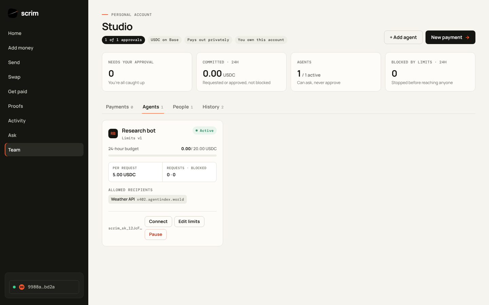
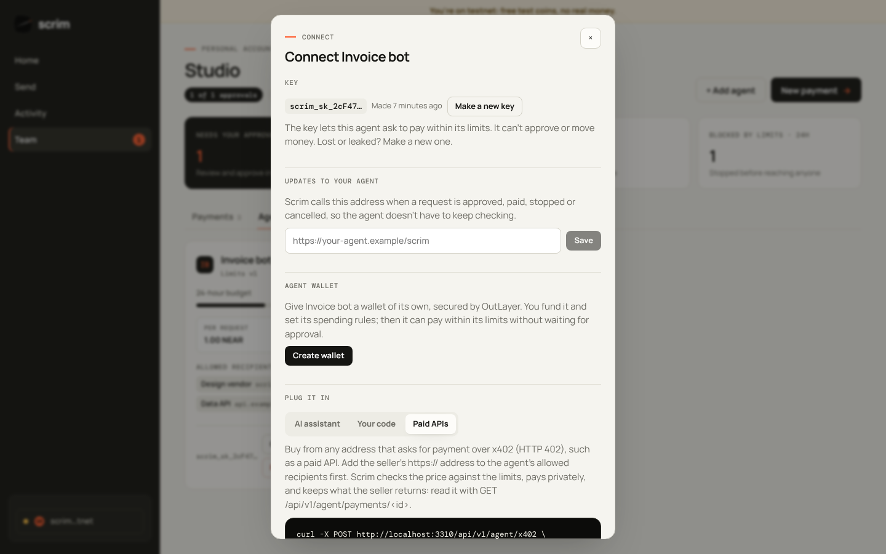
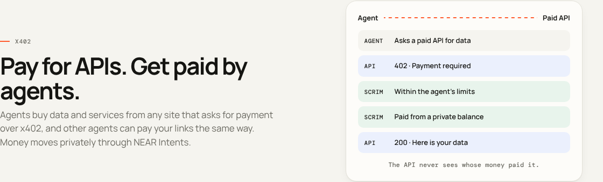

# Agents and x402

An **agent** is a helper that spends for you, only inside the rules you set: an AI assistant, a payroll script, a billing job. It works on personal and shared accounts. By default an agent *asks* to pay and people approve. With a wallet of its own, the owner can let it pay by itself within its limits.

**What is x402?** A way to pay online for a paid service. A website says "pay a few cents to use me", the agent pays, and it gets what it asked for. An agent uses x402 as one way to spend; every x402 payment counts against the same limits as any other payment.

**The agent's key.** When an owner adds an agent (Accounts → Agents), Scrim shows a key once, starting with `scrim_sk_`. The software sends it as `Authorization: Bearer scrim_sk_…`. The key can ask to pay within the agent's limits. It cannot approve, change limits or move money, and it is not a wallet key. Scrim stores only a hash. If it is lost or leaked, **Connect → Make a new key** replaces it and the old one stops at once.

**Limits.** Per payment, per time window (for example per day), a list of allowed recipients, and an optional expiry. Every change creates a new version with a fingerprint, so there is a record of what applied when. Requests outside the limits are stopped before any person sees them. Anyone who approves on the account can pause an agent; only the owner can resume it.

**Repeats.** A request that repeats one from the last 10 minutes (same recipient, same amount) waits for a person, even inside the limits, and an agent with its own wallet does not pay it by itself. A false "the payment failed, retry" note is how an agent would pay twice. A payment that really failed or was cancelled can be retried at once, and x402 purchases are not held.

**Check before paying.** An agent can ask whether a payment would be allowed without requesting it: the tool `check_payment`, or `POST /api/v1/agent/check` with `{recipient, amount}`. The answer is `allowed`, `needs_person` (inside the limits, but a person confirms it first) or `refused`, with a code for each reason: `AGENT_PAUSED`, `MANDATE_EXPIRED`, `RECIPIENT_NOT_ALLOWED`, `OVER_PAYMENT_LIMIT`, `OVER_WINDOW_LIMIT` or `REPEAT_REQUEST`. An agent should call it whenever text it was given (an invoice, a note, a web page) tells it to pay.

**Tested against attacks.** `tests/redteam.test.ts` has an AI model with no refusals write attacks (poisoned invoices, fake retry notes, look alike sellers, urgent orders) and then play an agent that does what documents say. With the check tool removed, the agent was talked into asking to pay six times, at amounts far above its limits and to look alike and attacker addresses. The limits stopped all six. It runs only when `NEARAI_REDTEAM_KEY` is set.

**Connect an AI assistant (MCP).** Scrim is an MCP server at `/api/mcp`:

```json
{ "mcpServers": { "scrim": { "type": "http", "url": "https://<your-site>/api/mcp", "headers": { "Authorization": "Bearer scrim_sk_…" } } } }
```

Tools: `get_limits`, `check_payment`, `request_payment`, `find_paid_apis`, `pay_x402`, `list_payments`, `get_payment`.

**Connect code (HTTPS).**

| Call | What it does |
| --- | --- |
| `GET /api/v1/agent` | Limits and what is left to spend |
| `POST /api/v1/agent/check` | Would this be allowed? `{recipient, amount}`. Nothing is requested |
| `POST /api/v1/agent/payments` | Ask to pay: `{recipient, amount, memo}` with an `Idempotency-Key` header |
| `GET /api/v1/agent/payments` | Recent requests |
| `GET /api/v1/agent/payments/:id` | One request, and for an x402 purchase what the seller returned |
| `GET /api/v1/agent/x402/search?q=` | Find paid APIs in the public x402 catalog, with price and whether this agent can pay |
| `POST /api/v1/agent/x402` | Buy from an x402 seller: `{url}` with an `Idempotency-Key` header |

**Updates (webhooks).** Set an `https://` address under **Connect** and Scrim calls it when a request is created, stopped, approved, being paid, paid, failed or cancelled. Each call carries `Scrim-Signature: t=<unix seconds>,v1=<hex>`, where `v1` is the HMAC-SHA256 of `"<t>.<raw body>"` with the signing secret (`whsec_…`, shown once). Reject calls with a wrong signature or a timestamp older than five minutes. Only public addresses are allowed.

<table>
  <tr>
    <td></td>
    <td></td>
  </tr>
  <tr>
    <td align="center">An agent on mainnet: limits in USDC</td>
    <td align="center"><b>Connect</b>: key, updates, its own wallet, setup</td>
  </tr>
</table>

<p align="center"></p>

**Get paid by agents (x402).** Every payment link also has an agent address, `/api/x402/pay/<code>`, that speaks [x402](https://x402.org) with the `exact` scheme and the `near-intents` upfront method (as proposed in x402-foundation/x402#3370). An agent gets a `402 Payment Required` listing USDC and USDT on Ethereum, Base, Arbitrum, Optimism, Polygon, BNB Chain, Avalanche and Solana, asks for a quote, pays the one-time deposit address, and presents the transaction. NEAR Intents delivers the money where the link owner chose: their private balance (the payer never sees where it went) or their wallet. Scrim acts as the facilitator: operation tokens are HMAC-bound to the deposit, the resource and the destination, each operation settles once, and refunds go straight back to the payer.

**Sell with x402.** Open **Sell**, name what you sell, set a price and choose what the buyer gets: a text or link, or your own API (with an optional secret header), which Scrim calls only after the payment is confirmed. Each product gets two addresses: one for agents (`/api/x402/pay/<code>`) and one for people (`/pay/<code>`). It can be bought any number of times. Agents pay with the `near-intents` method above; the 402 answer names the product. On a confirmed payment the agent receives the product in the same response, and presenting the same paid deposit again returns it again rather than charging twice. Sales land in your private balance or your wallet, as you chose, and appear in the product's **Sales** list (when, paid with what, what arrived), with buyers kept anonymous.

**Buy from x402 sellers (agents).** An agent can also *pay* an x402 address, such as a paid API: `POST /api/v1/agent/x402` with `{ "url": "https://…" }`, or the MCP tool `pay_x402`. Scrim reads the seller's `402`, picks a NEAR Intents route (USDC on Base preferred), prices it in USD, and files a payment request named after the seller's web address. The agent's limits apply (the seller's `https://` address must be one of its allowed recipients) and people approve as usual; an agent with its own wallet pays the seller by itself instead, from its private balance by default. When the owner pays, Scrim gets a fresh quote from the seller, never above what was approved, and pays the quoted deposit address with a private withdrawal the owner's wallet signs. Refunds go to the owner's own deposit address, so they return to the private balance. Once NEAR Intents delivers, Scrim presents the payment to the seller and keeps the response for the agent (`GET /api/v1/agent/payments/:id` or `get_payment`). The seller never sees your wallet.

**Agents that pay by themselves.** The owner can give an agent its own wallet: **Connect → Create wallet**. The wallet is an [OutLayer](https://outlayer.ai) agent wallet: its key is created and kept inside a secure enclave (Intel TDX) and never reaches Scrim, which stores only the wallet's access key, sealed. The owner funds it and sets its spending rules on OutLayer with their own NEAR wallet, so the wallet enforces a second, independent set of limits. With **Let it pay by itself** on, a request that passes the agent's Scrim limits is paid at once from the agent's wallet; anything outside them is stopped as before. On testnet it sends NEAR and Scrim checks the transfer on-chain. On mainnet it sends USDC, x402 purchases included, and the owner chooses per agent:

| | Private (default) | Public |
| --- | --- | --- |
| Funding | **Add funds privately**: an address on Base, Ethereum, Arbitrum, Solana or NEAR that credits the private balance | OutLayer's funding page |
| Payments leave from | The wallet's private balance | The wallet's public NEAR Intents balance |
| What the public chain shows | The payment arriving, not which wallet sent it | Every payment, from the agent's wallet |

**Buy from any x402 seller (agents with their own wallet).** Most x402 sellers take a standard payment: a signed USDC authorization on an EVM chain, or a Solana transfer. An agent with its own wallet pays these too, on Ethereum, Base, Arbitrum, Optimism, Polygon, BNB Chain, Avalanche and Solana, with the `exact` scheme or, on EVM chains, `upto` (pay for what was used, up to the price shown). Scrim builds the payment with the x402 reference client ([`@x402/evm`](https://www.npmjs.com/package/@x402/evm), [`@x402/svm`](https://www.npmjs.com/package/@x402/svm)) and the wallet signs it inside OutLayer's enclave; the seller's payment service pays the fee. If the wallet's address on that chain is short, Scrim first tops it up from the agent's private balance, so the seller never sees where the money came from. `find_paid_apis` (or `GET /api/v1/agent/x402/search?q=`) searches the public catalog and marks what the agent can pay.

**Alerts for people.** Approvers can tap **Connect Telegram** on the Accounts screen to get a message when a payment needs them.
