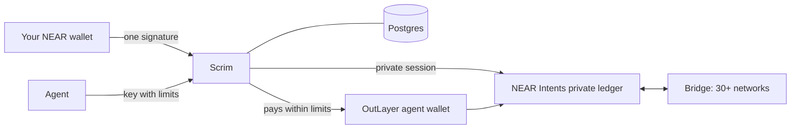
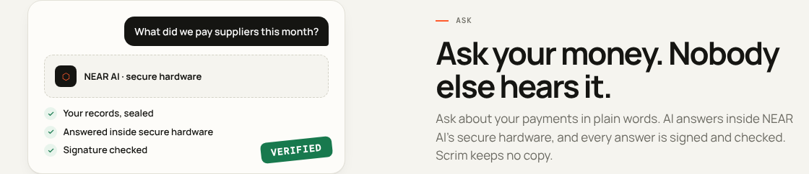

# How Scrim works

**Sign in.** You approve one plain message in any NEAR wallet. It names Scrim and the site you opened, and it cannot move money, so a look-alike site asking for a signature stands out. Scrim checks on-chain that the key really belongs to your account. Opening your private balance is a separate, optional step: a second message, the NEAR Intents ownership message (a signed empty intent that cannot move funds), approved only when you choose to use private money.

**Move money.** Scrim asks NEAR Intents for a price, then your wallet signs the exact transfer. Scrim checks the signature against the exact payload before submitting, and it can be used once. Scrim then follows the transfer to the end and shows you each stage.

**Prove a fact.** A proof is a short statement ("holds at least…" or "paid…") made for one reader, signed by Scrim, with an expiry. The reader opens a link and the check runs in their browser, without an account.

**Set rules.** A request (from a person or an agent) is first checked against the rules. Anything outside them is stopped before anyone sees it. The rest waits for the number of approvals you chose, each given by a wallet signature tied to that exact amount and recipient. Approved requests are paid from the owner's private balance on mainnet, or with a real NEAR transfer on testnet that Scrim reads back from the chain before marking it paid. An agent with its own wallet can skip the approval step, within the same limits.

**Ask your money (NEAR AI Cloud).** The Ask screen sends your question and your own records (balances, payments, requests in your accounts, wallet transactions) to a model running in NEAR AI Cloud's confidential hardware (Intel TDX and NVIDIA confidential GPUs). Before asking, Scrim fetches the model's attestation report with a fresh nonce. After, it checks the answer's signature over the exact request and response bytes, and that the signing key is the one the report names. Scrim keeps no copy of the question or the answer. The first question is free; after that, people pay with their own USDC, from their private balance or straight from their wallet, as they choose: they add $1, $5 or $20 of questions (2 cents each by default), approved once in their wallet, and unused questions never expire. A wallet payment is read back from the chain and credited once. Set `NEARAI_API_KEY` to switch it on, and `ASK_FEE_ACCOUNT` (the NEAR account that receives those payments) to let people buy more; `ASK_PRICE_USD` and `NEARAI_MODEL` are optional.

## Where the data comes from

Coins, prices, logos and networks come live from NEAR Intents and CoinGecko. Paid APIs come from Coinbase's public x402 catalog, and Ask's answers from NEAR AI Cloud. Testnet balances come from the NEAR RPC and FastNEAR, and Activity reads each wallet's transactions from FastNEAR's transaction index. Nothing is hardcoded.
