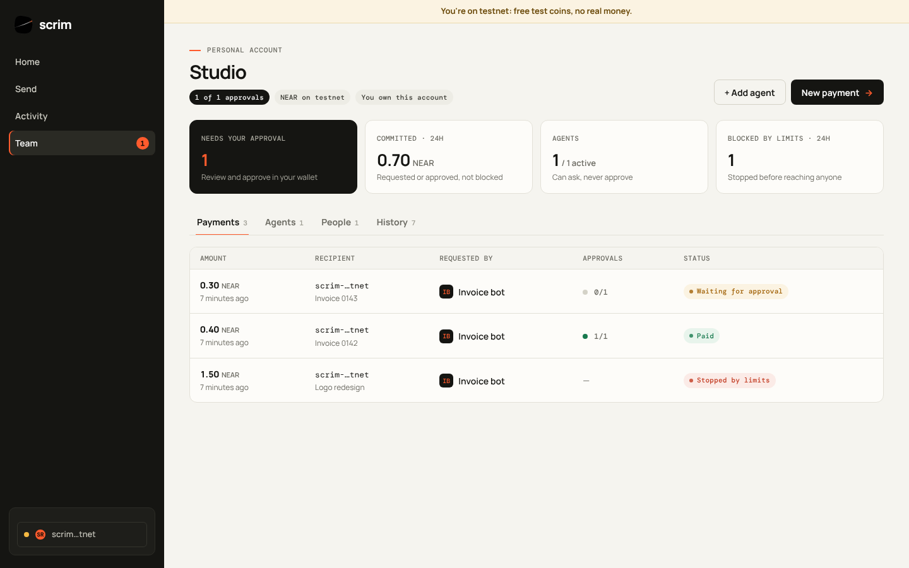
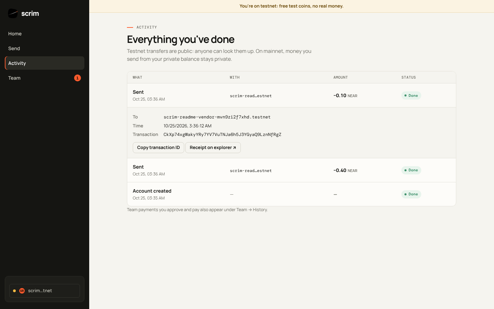

# Try Scrim

The live site is **https://scrimfinance.vercel.app**. Each step says what to do and what you should see. Steps 1–8 and 11 use testnet and free test coins; steps 9, 10 and 12 use mainnet.

You need a NEAR testnet account. Any NEAR wallet can create one for free, for example [Meteor](https://wallet.meteorwallet.app) or [HOT](https://hot-labs.org).

1. **Sign in.** Open `/app`, choose **Testnet**, pick your wallet and approve the sign-in message. → You see your account name and its real testnet NEAR balance. The message cannot move funds.
2. **Read your activity.** Open **Activity**. → Your wallet's own transactions, read from the chain, in plain words (Sent, Received, Got test NEAR…). Tap one to see who it was with, the time and the transaction ID.
3. **Send.** Open **Send** and send `0.1` NEAR to another testnet account. → Your wallet asks you to approve; then the transfer appears at the top of **Activity** as *Sent*, *Done*.
4. **Set up an account with rules.** Open **Accounts**, choose *Shared*, add a second NEAR account as an approver, require 2 approvals and tap **Create account**. → The account shows "Payments need 2 of 2 approvals". (Choose *Just me* to approve alone.)
5. **Add an agent.** In the account, open **Agents → Add agent**. Set *1* per payment, *1.5* per day, and allow one recipient. → Scrim shows the agent's key once (`scrim_sk_…`).
6. **The agent asks to pay.** From any terminal:
   ```sh
   curl -X POST https://scrimfinance.vercel.app/api/v1/agent/payments \
     -H "Authorization: Bearer scrim_sk_…" -H "Idempotency-Key: try-0001" -H "content-type: application/json" \
     -d '{"recipient":"<the allowed account>","amount":"0.5","memo":"first try"}'
   ```
   → `"status": "awaiting_approval"`. Repeat with `"amount":"2"` and a new key: → `"status": "policy_rejected"`, stopped before anyone sees it.
7. **People approve.** In the account, open the request and tap **Approve with wallet** from each account, then **Pay with my wallet**. → Status moves to *Paid* only after Scrim reads the transfer back from the chain.
8. **Use it from an AI assistant.** Add Scrim as an MCP server (see [Agents](AGENTS_GUIDE.md)) and ask the assistant "what can you still spend?". → It calls `get_limits` and answers with the agent's limits and what is left.
9. **Private balance (mainnet).** Sign in on **Mainnet** and open **Add money**. Pick a coin and a network. → A one-time deposit address. What you send there lands in your private balance, where the public chain shows nothing about what you hold.
10. **Get paid by an agent (mainnet).** Make a payment link, then request its agent address:
    ```sh
    curl -i https://scrimfinance.vercel.app/api/x402/pay/<link code>
    ```
    → `402 Payment Required` with a `PAYMENT-REQUIRED` header listing USDC and USDT routes on eight chains, all delivered where the link owner chose: their private balance or their wallet.
11. **Ask about your money.** Open **Ask** and tap "What do I hold right now?". → A plain answer from your own records, with **Signed by the attested key**: the answer was signed over exactly this question and answer, by the key NEAR AI's attestation report names for the model.
12. **An agent that pays by itself (mainnet).** In **Agents → Connect**, choose **Create wallet**, keep **Private**, use **Add funds privately**, then **Let it pay by itself**. → Requests inside the agent's limits go straight to *Paid*, from the agent's wallet (its private balance when set to Private), with no approval step.

## Testnet and mainnet

Choose a network when you sign in. Everything shown is real data from the network you pick. There is no sample or placeholder content.

| | Testnet | Mainnet |
| --- | --- | --- |
| Money | Free test coins, worth nothing | Real money |
| Sign-in and approvals | ✅ | ✅ |
| Spending limits and agents | ✅ | ✅ |
| Agents that pay by themselves (own wallet) | ✅ NEAR | ✅ USDC |
| Real NEAR transfers, checked on-chain | ✅ | ✅ |
| Activity, read from the chain | ✅ | ✅ |
| Ask about your money (private AI) | ✅ | ✅ |
| Private balance, add money, send, swap | — | ✅ |
| Payment links and proofs | — | ✅ |
| x402: find and buy paid APIs, get paid by agents | — | ✅ |
| Private agent wallets | — | ✅ |

Private options need NEAR Intents, which only exists on mainnet; testnet is public. On testnet those screens say so plainly. The recommended path is to try Scrim on testnet first, then move to mainnet with a separate account and small amounts.

On testnet, an account with an agent's requests (one waiting, one paid on-chain, one stopped by its limits), and Activity read from the chain:

<table>
  <tr>
    <td></td>
    <td></td>
  </tr>
</table>
